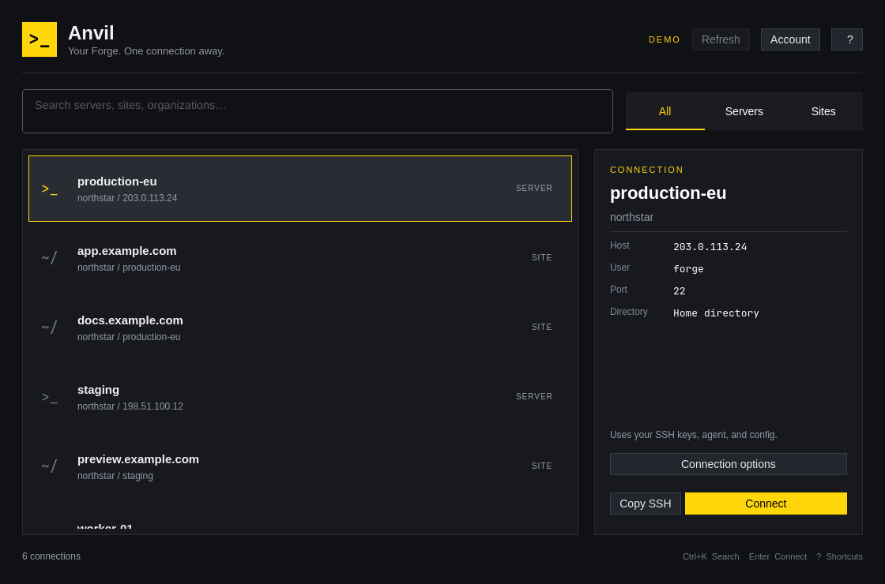

Anvil is a small Laravel Forge SSH directory for the Omarchy desktop. It fetches the organizations, servers, and sites available to your API token, then opens your chosen connection in your Omarchy terminal. Site connections use the site's SSH user and project root directory.

Built with C++ and Qt Quick, packaged with makepkg, and installed as a single binary. The accent, window rounding, and language follow Omarchy live. English and Danish catalogs are included; other languages fall back to English.

## Get started

Open **Anvil** from the application launcher (`Super + Space`), choose **Connect Laravel Forge**, and enter a token from [Forge's API settings](https://forge.laravel.com/profile/api). The token needs access to list organizations, servers, and sites. The app only makes GET requests to Forge.

Leave **Remember in the desktop keyring** checked to save the token through Secret Service (`secret-tool`). Uncheck it to keep the supplied token in memory for this session. **Account → Forget token** clears the saved credential. The app does not write a token, inventory cache, or SSH configuration to disk.

Search by server, site, organization, SSH user, or IP address. Select an entry and press Enter. OpenSSH handles authentication, host verification, and any password or key passphrase prompts in the terminal. Your public key must already be authorized on the selected server or site user.

**Connection options** accepts a hostname or existing SSH config alias, SSH user, port, and optional identity file path. These overrides last for the current selection. Forge's user and port are passed explicitly; set overrides if your SSH alias needs different values. The app never deploys code, changes Forge resources, or uploads SSH keys.

## Shortcuts

| Key | Action |
| --- | --- |
| Ctrl+K | Focus search |
| Up / Down | Select a connection |
| Enter / Space | Open SSH in your terminal |
| Ctrl+Shift+C | Copy the SSH command |
| Ctrl+R | Refresh inventory |
| Ctrl+, | Manage API token |
| Esc | Close a dialog or clear search |
| ? | Show shortcuts |
| Q | Quit |

Typing in text fields retains normal editing and undo/redo behavior. Single-letter shortcuts are inactive while editing.

## Build and install

```sh
bin/build
bin/test
bin/install
```

Requires Qt 6 base/declarative/Wayland, a C++17 compiler, qmake6, make, OpenSSH, libsecret, and Omarchy. `bin/install` uses `makepkg -fsi` to install the binary, launcher entry, icon, and license. Remove the package with `sudo pacman -R anvil`.

Run `build/anvil open --demo` for an inventory with fictional servers. Demo mode cannot open SSH connections or store tokens. Tests exercise a local mock Forge API, command construction, a fake terminal launcher, theme replacement, language changes, and the real QML UI offscreen. They regenerate screenshots in `docs/` with fictional data and a fixed default accent.

## Agent commands

```sh
anvil check --json
anvil list --json
anvil command --target 'organization:site:123' --json
anvil skill install --json
```

Inventory commands read `FORGE_API_TOKEN` from the environment; provide it through your secret manager, keeping it out of command arguments and shell history. Commands work without a display, emit JSON, and exit 0 or 1. Errors go to stderr. `command` prints a quoted SSH command without executing it. `skill install` installs the bundled guide at `~/.agents/skills/anvil/SKILL.md`, refusing to overwrite an existing file.

## API and limits

Uses the [current Forge API](https://laravel.com/forge/docs/api-reference/introduction), organization-scoped server/site endpoints, and [cursor pagination](https://laravel.com/forge/docs/api-reference/pagination). Requests run sequentially, have timeouts, and reject redirects and foreign pagination links. Permission failures and rate limits appear in the window. Refresh again after a rate limit's stated wait.

No real Forge account is included in the tests. Live inventory and remote SSH authentication require your token and existing server access.

Theme and translation infrastructure follows the MIT-licensed Omarchy app templates derived from Omacut and Monologue by David Heinemeier Hansson. See LICENSE.
